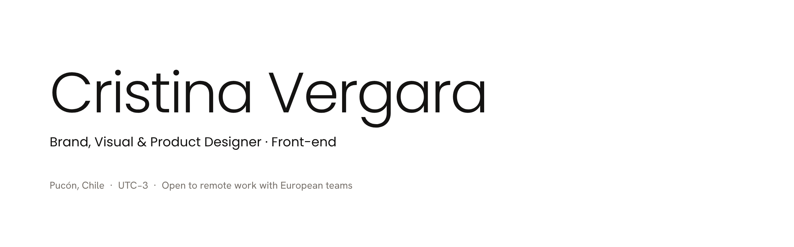
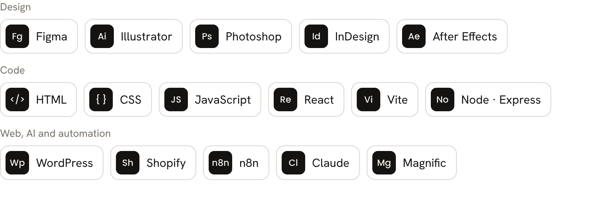
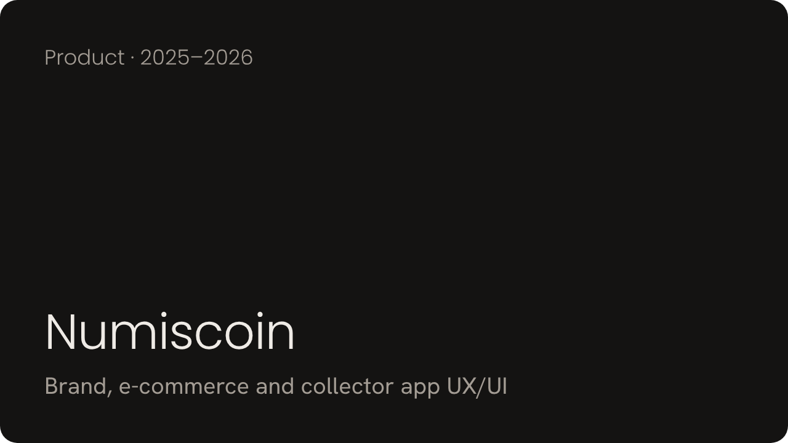
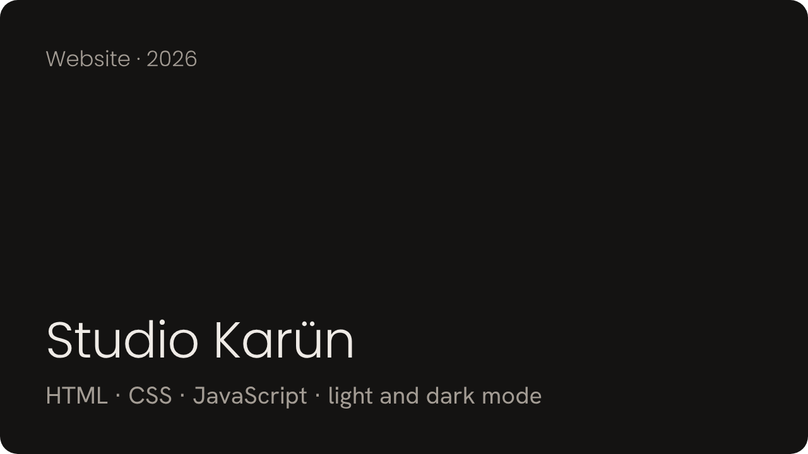
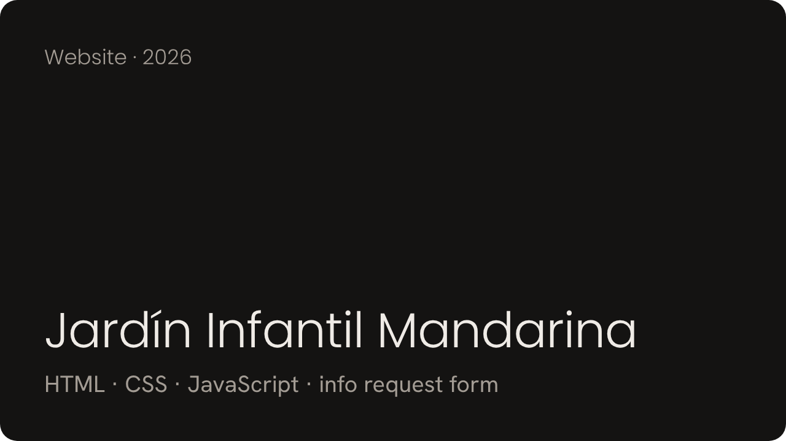
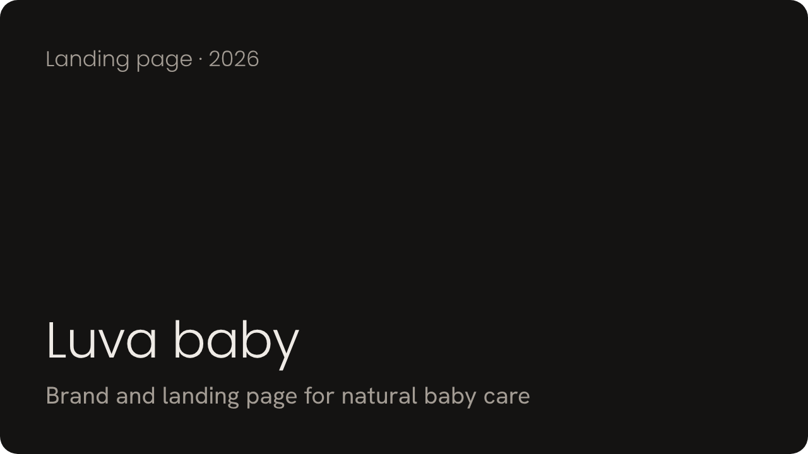
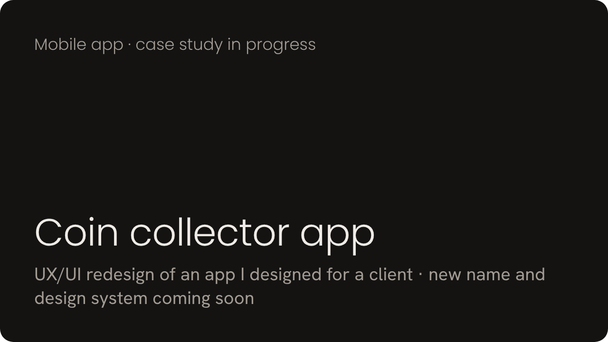
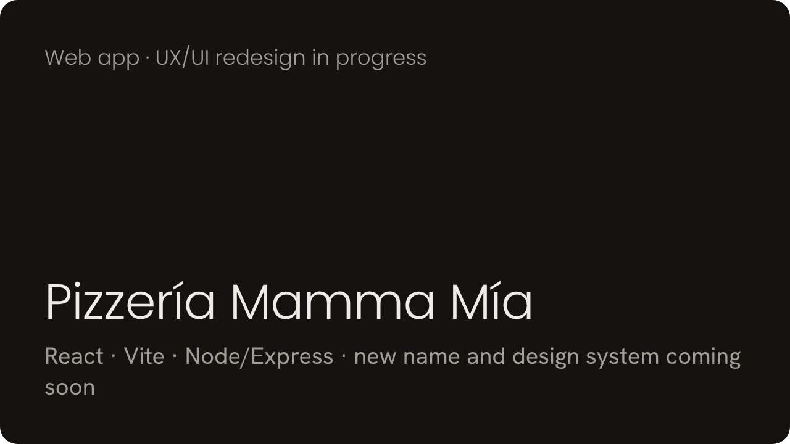
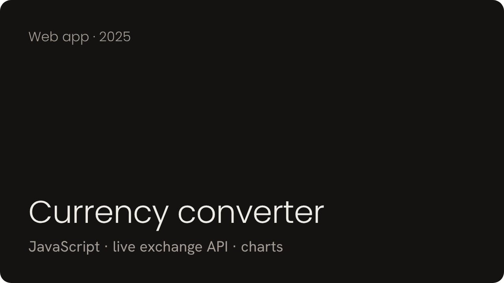
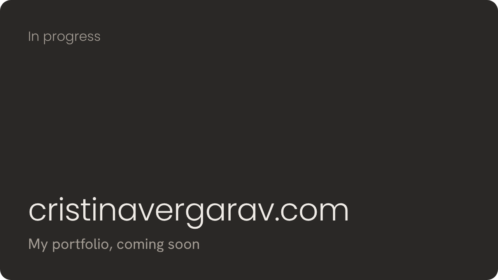

<picture>
  <source media="(prefers-color-scheme: dark)" srcset="assets/banner-dark.png">
  
</picture>

 

Hi, I'm Cristina. I design brands, packaging and digital products, and I build the front-end myself.

For more than a decade I've worked with food, hospitality, beauty and culture brands, from the first sketch to the live website. I founded Studio Karün in 2016 and trained at the e[ad] School of Architecture and Design (PUCV), where I learned to observe before making.

 

<i>“I design to create meaningful connections between people, ideas and experiences. Every detail is an opportunity to make the world feel a little more intuitive, human and honest.”</i>

— Cristina Vergara

 

## Currently

- Completing the UI/UX Design Specialization (CalArts)
- Building my portfolio at [cristinavergarav.com](https://cristinavergarav.com)
- Exploring AI-assisted design and automation workflows

## What I do

**Brand & packaging** · Identities, brand systems, packaging lines and editorial design.

**UX/UI & product** · User flows, wireframes, prototypes and design systems in Figma.

**Front-end** · Responsive sites in HTML, CSS and JavaScript, React apps, WordPress and Shopify.

## Toolkit

<picture>
  <source media="(prefers-color-scheme: dark)" srcset="assets/toolkit-dark.png">
  
</picture>

## Selected work

  
  

  
  

  
  

  
  

## Languages

**Spanish** · Native 
**English** · C2 reading & listening (EF SET) · spoken B2, improving

## Contact

Open to Brand, Visual and Product Designer roles · remote, or relocation to Europe in 2027.

Pucón, Chile · UTC−3
